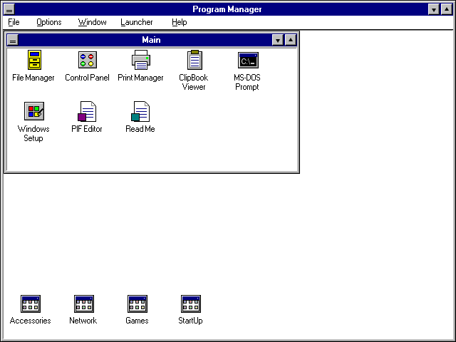
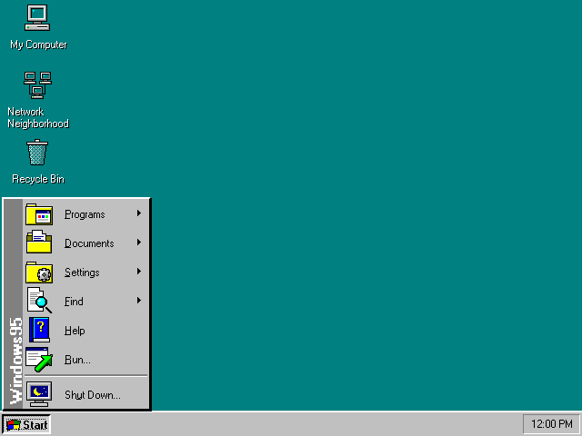
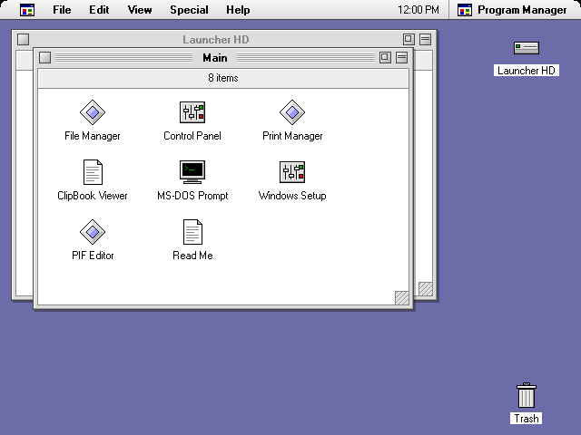
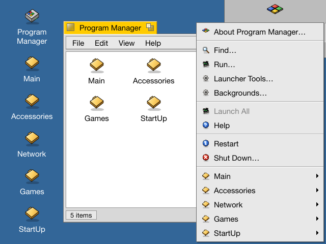

# Program Manager

Program Manager is a retro desktop launcher inspired by Windows 3.1. It lets you organize apps, URLs, scripts, and folders into classic program groups, then launch them from a nostalgic app on Windows, macOS, and Linux.

The current version is **2.1.0**. The 2.x series is a ground-up rewrite in **Godot 4** (GDScript). It uses the same JSON data layout as the 1.x Electron build. Compatibility with 1.x data was not re-verified in the 2026-11-14 audit.

## What It Does

1. Switch between an isolated WfW 3.11 Program Manager, a Windows 95 RTM-style launcher desktop, a Classic Mac OS-style desktop and a BeOS-style desktop with Deskbar.
2. Launch through the canonical Windows 95 path: **Start → Programs → group → app**, or open groups from My Computer.
3. Scale any shell crisply at independent Auto/1×/2×/3×/4× integer factors on modern displays.
4. Create program groups and fill them with apps, links, scripts, or files.
5. Drag files into a group window to add them quickly.
6. Launch items from the desktop, Find, Run, or the system tray.
7. Batch launch numbered groups from 1 to 8 with a delay you control.
8. Import and export original Windows 3.x `.GRP` files.
9. Save named workspace profiles with independent Win31 and Win95 layouts.
10. Configure arguments, environment variables, working directories, run modes, and shortcut keys (shortcut keys work in the Windows for Workgroups shell only).
11. Use the separate Launcher Tools window for URLs, batch metadata, profiles, shell switching, scale options, and JSON transfer.
12. Recover from automatic versioned backups or create manual restore points.
13. Optionally place Program Manager on a gray WfW desktop and minimize it to its classic desktop icon.
14. Use RTM-style multi-selection, marquee selection, all four folder views, deterministic scrollbars, task/system/context menus, and outline move/size in Windows 95.

## Screenshots

These are real renders of the app with clean sample data, taken by `tools/capture_screenshots.sh`.

| Windows for Workgroups 3.11 | Windows 95 |
|---|---|
|  |  |
| **Classic Mac OS** | **BeOS** |
|  |  |

More views, including dialogs, dark themes and 2×/3× scaling, are in the [handbook](docs/handbook/index.html).

## Run

You need [Godot 4.7](https://godotengine.org/download) (the standard build; .NET is not required). The repository pins version 4.7.2.

```bash
git clone https://github.com/goshitsarch-eng/Gosh-Retro-Launcher.git
cd Gosh-Retro-Launcher
godot --headless --path . --import
godot --path .
```

You can also open `project.godot` in the Godot editor and press F5.

## Build

Export presets for Windows, macOS, and Linux are in `export_presets.cfg`. With the matching export templates installed, run the import step above, then build from the repository root. Build the macOS preset on macOS with Apple’s codesign tool.

```bash
mkdir -p build
godot --headless --path . --export-release "Linux x86_64" build/program-manager.x86_64
godot --headless --path . --export-release "Windows x86_64" build/program-manager.exe
godot --headless --path . --export-release "macOS" build/program-manager.zip
```

The project enables ETC2 ASTC texture import in its settings, which the universal macOS export requires. Without that setting, Godot stops the macOS export with an error (see the handbook's troubleshooting chapter).

`tools/package_linux.sh` wraps the Linux export into `.tar.gz` and `.deb` packages. See [Platform integration](docs/PLATFORM.md) for CI, signing, and the pinned Godot version.

## Development

```bash
# unit tests (headless)
godot --headless --path . --script tests/run_tests.gd

# regenerate the screenshots in docs/screenshots (needs a desktop session)
tools/capture_screenshots.sh

# render a scenario with the real app and diff it against a committed baseline
# (captures pick a temporary profile themselves; PM_USER_DATA still makes the intent explicit)
PM_USER_DATA="$(mktemp -d)" godot --path . -- --capture=win95-start --out=artifacts/win95-start.png
python3 tests/visual/compare.py artifacts/win95-start.png tests/visual/baselines/win95-start.png  # needs numpy and Pillow
```

## Project Shape

| Path | Contents |
|------|----------|
| `src/core` | Data model, migration, store, backups, launcher, `.GRP` codec, search, UI/MDI state (autoloads `ProgramStore`, `UIState`, `MdiState`) |
| `src/toolkit` | Pixel-exact drawing: bitmap text, bevels, palette, scaling, icon registry |
| `src/shells/win31` | Windows for Workgroups shell, MDI windows, dialogs, Quick Search, Launcher Tools |
| `src/shells/win95` | Windows 95 shell: desktop, taskbar, Start, windows, folder views, Find, dialogs |
| `src/shells/mac` | Classic Mac OS shell: menu bar, Launcher HD and folder windows, Get Info, Trash, Find (see `docs/MAC_SHELL.md`) |
| `src/shells/be` | BeOS shell: tabbed windows, Deskbar, Get Info, Find (see `docs/BE_SHELL.md`) |
| `src/platform`, `src/app` | Tray, single instance, native dialogs, icon extraction, sounds, window management (autoloads `Platform`, `Sounds`) |
| `tests` | Unit tests and the visual regression harness |

## Documentation

The [November 19 desktop audit](docs/qa-2026-11-19/README.md) lists platform builds, hands-on results, screenshots and outstanding coverage.

1. [Handbook](docs/handbook/index.html): open this file in a browser. It is the full manual, with architecture, build and release, troubleshooting, audit findings and coverage. It works offline.
2. [User Guide](docs/USER_GUIDE.md): a short guide that points to the handbook
3. [Architecture](docs/ARCHITECTURE.md)
4. [Platform integration and known differences](docs/PLATFORM.md)
5. [Electron → Godot parity checklist](docs/PARITY.md)
6. [Windows 95 RTM source-cited audit](docs/RTM_AUDIT.md)
7. [Changelog](CHANGELOG.md)
